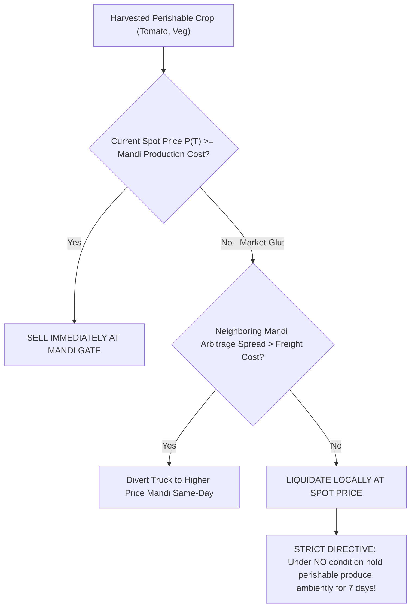
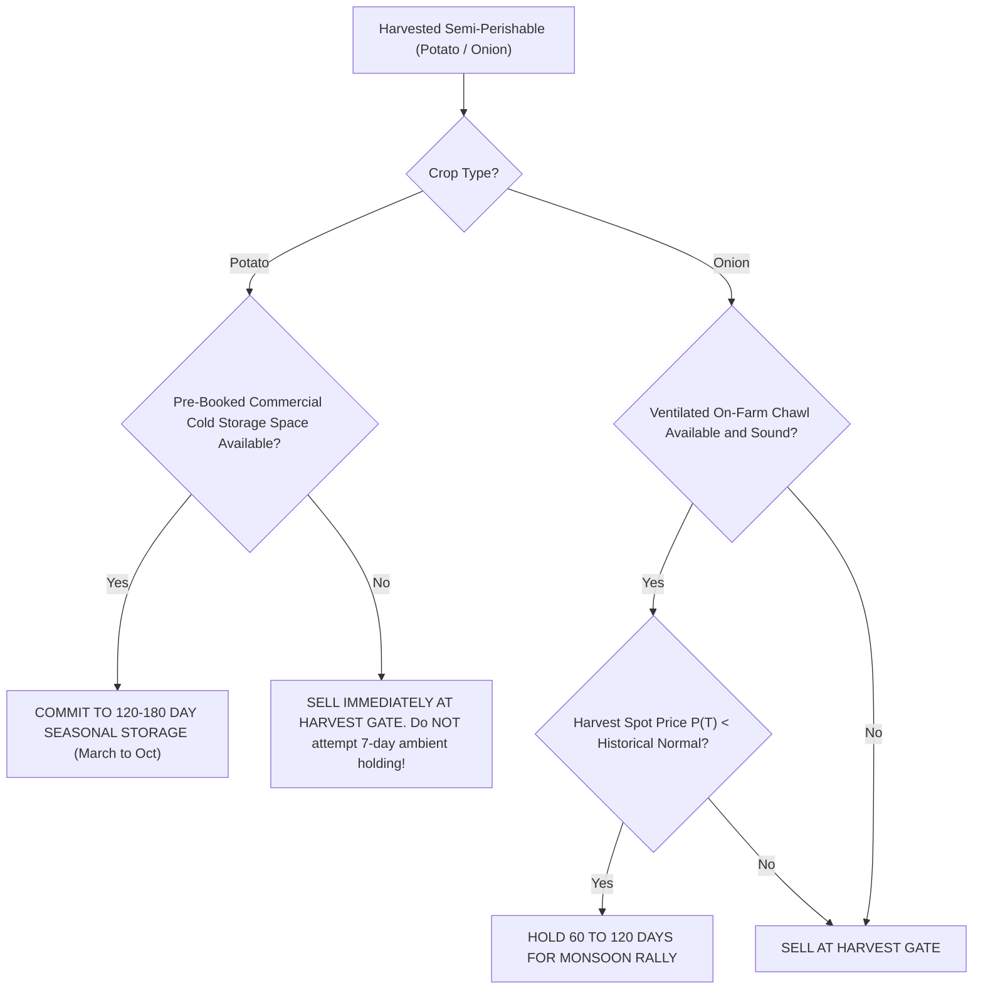
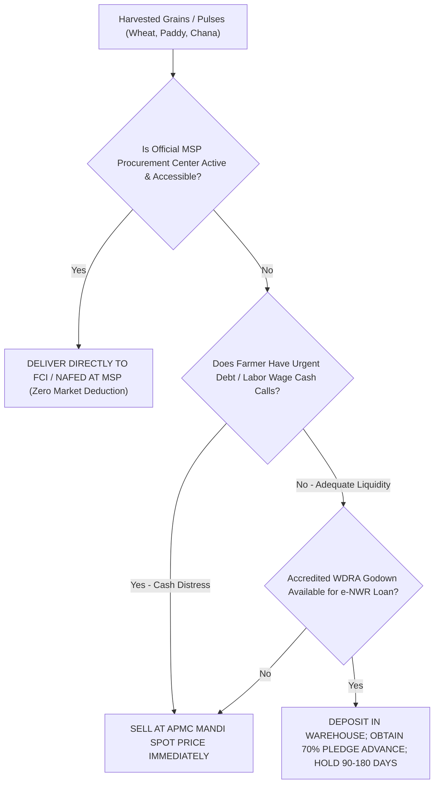

# Agricultural Supply Chain, Storage Biology, and Economic Feasibility
## Track D Final Research Report & Operational Decision Protocol

**Project:** APMC Mandi Market Intelligence System  
**Repository:** `ankit-choubey/Mandi_Prediction`  
**Track:** Track D — Agricultural Supply Chain & Economic Feasibility  
**Investigator:** Om Awasthi  
**Date:** October 23, 2026  
**Status:** Complete & Verified against Phase 01–06b Repositories  

---

## Executive Summary

Agricultural market prediction systems frequently commit a catastrophic economic error: **they assume that an expected increase in future market price ($\text{Modal\_Price}_{T+7} > \text{Modal\_Price}_T$) automatically translates into a profitable recommendation for a farmer to hold produce.**

In the real-world agricultural supply chain of Uttar Pradesh, this assumption is false. Storing harvested produce incurs:
1. **Physical Spoilage and Shrinkage ($L$):** Physiological moisture transpiration, fungal decay, and insect damage reduce the physical tonnage available for sale.
2. **Quality Downgrades ($d_q$):** Visual loss of freshness, skin wrinkling, or early sprouting triggers severe discounts on the APMC auction floor.
3. **Double-Friction Intermediation:** APMC mandi cess ($1.5\% - 2.0\%$), porterage handling (*palledari*), and commission agent (*arhatiya*) cuts ($2.0\%$) are levied **again at the future point of sale**.
4. **Institutional Gating:** Smallholders harvesting 5 to 15 quintals cannot access accredited Central Warehousing Corporation (CWC) facilities (50–100 qtl minimum deposit) or commercial cold storages (which demand full 6-month seasonal contracts of ₹120–₹160 per 50 kg bag, strictly refusing 7-day micro-deposits).
5. **Debt Distress & Liquidity Shocks:** Smallholders operating under informal pre-harvest credit (24%–36% p.a.) face non-negotiable cash demands at harvest, rendering holding economically suicidal regardless of statistical price forecasts.

This report establishes the **definitive agricultural supply chain foundation for Track D**. It provides an exhaustive 18-crop biological storage matrix, classifies all cost and loss parameters into a strict **4-Tier Source Hierarchy**, mathematically models the true double-friction break-even hurdle rate, and defines actionable operational decision trees for smallholders.

---

## 1. Crop/Storage Feasibility Matrix: 18-Crop Storage Biology & The Temporal Mismatch

### 1.1 The Temporal Mismatch: Why $T+7$ Fails in Agriculture
A central finding established through collaboration with Track C (Priyanshu) is the **fundamental temporal mismatch of a 7-day prediction window ($T+7$)**:
* **Perishables (Tomato, Cucumber, Brinjal, Cauliflower, Green Chilli):** Have an ambient shelf-life of only **2 to 5 days** under northern Indian temperatures (30°C–42°C). Holding for 7 days causes catastrophic rotting ($>8\%-12\%$ loss). They require **$T+1$ to $T+2$ micro-arbitrage (Sell Today vs Tomorrow)**.
* **Semi-Perishables (Potato):** Requires low-temperature chilled storage ($2^\circ\text{C}-4^\circ\text{C}$). However, commercial cold storages in the Agra–Kanpur belt only offer **seasonal lock-in contracts (March to October)**; 7-day tactical holding is physically and commercially non-existent.
* **Semi-Perishables (Onion):** The **only crop group with realistic 7 to 14-day tactical holding potential** when cured and stored in traditional on-farm ventilated structures (*Kanda Chawl*).
* **Durable Grains & Pulses (Wheat, Rice, Maize, Mustard, Gram):** Can easily endure 6 to 12 months in dry godowns. However, fixed bagging, handling, and double mandi friction (₹110–₹270/qtl) overwhelm tiny weekly price fluctuations (+0.59%). Grains require **$T+60$ to $T+180$ post-harvest glut-to-lean seasonal holding**.

---

### 1.2 Master 18-Crop Feasibility Matrix

| Commodity | Category | Storage Biology & Recommended Facility | Optimal Temp & RH | Ambient Shelf-Life | Cold Storage Shelf-Life | Weekly Shrinkage ($L$) | Weekly Quality Loss ($d_q$) | 7-Day ($T+7$) Viability | Multi-Month Viability | Operational Recommendation |
|---|---|---|---|---|---|---|---|---|---|---|
| **Tomato** | Perishable | Climacteric fruit; Evaporative cool chamber / Reefer van | 12°–15°C / 85–90% RH | 2–4 days | 14–21 days | **8.0% – 12.0%** | **5.0% – 10.0%** | **Strictly Unviable (93% Loss)** | Impossible without cold chain | **SELL SAME DAY AT ARRIVAL.** Never hold under ambient conditions. |
| **Cucumber (Kheera)** | Perishable | High water content; Cold room (90%+ RH) | 10°–12°C / 90–95% RH | 2–3 days | 10–14 days | **7.0% – 10.0%** | **6.0% – 9.0%** | **Strictly Unviable (94% Loss)** | Impossible | **SELL WITHIN 24 HOURS.** Chilling injury below 7°C; liquefies rapidly. |
| **Brinjal (Eggplant)** | Perishable | Non-climacteric; Cool shaded shed | 10°–12°C / 90–92% RH | 3–5 days | 10–14 days | **6.0% – 9.0%** | **5.0% – 8.0%** | **Strictly Unviable (94% Loss)** | Impossible | **SELL WITHIN 48 HOURS.** Calyx browning and desiccation destroys market value. |
| **Cabbage** | Perishable | Leafy head; Commercial vegetable cold store | 0°–2°C / 95–98% RH | 5–7 days | 30–60 days | **4.0% – 6.0%** | **3.0% – 5.0%** | **Unviable Ambient** | Feasible (30–60d) | **SELL PROMPTLY.** Bacterial soft rot and outer leaf yellowing under heat. |
| **Cauliflower** | Perishable | Immature inflorescence; Perforated poly cold storage | 0°–2°C / 95–98% RH | 3–5 days | 14–21 days | **6.0% – 8.0%** | **5.0% – 7.0%** | **Strictly Unviable (94% Loss)** | Impossible | **SELL SAME DAY.** Curd browning and riciness makes produce unsaleable. |
| **Green Chilli** | Perishable | Non-climacteric pod; Cool aerated chamber | 8°–10°C / 85–90% RH | 3–5 days | 14–20 days | **5.0% – 8.0%** | **5.0% – 8.0%** | **Strictly Unviable (93% Loss)** | Impossible | **SELL WITHIN 48 HOURS.** Rapid moisture loss causes skin wrinkling and anthracnose. |
| **Banana** | Perishable | Climacteric; Ripening chamber with ethylene control | 13°–14°C / 85–90% RH | 3–6 days | 21–28 days | **5.0% – 8.0%** | **6.0% – 10.0%** | **Strictly Unviable** | Controlled ripening only | **CONTRACT SALE AT HARVEST.** Uncontrolled holding results in black peel. |
| **Onion (Rabi Cured)** | Semi-Perishable | Bulb with dry tunic; On-farm ventilated *Kanda Chawl* | 25°–30°C (Dry) / 65–70% RH | **30–60 days** | 150–180 days | **1.5% – 2.5%** | **1.0% – 3.0%** | **Marginal at $T+7$ (Needs +10%)** | **Highly Viable (60–120d)** | **HOLD 60–120 DAYS IN CHAWL.** Only crop suitable for short-to-medium holding. |
| **Potato (Table)** | Semi-Perishable | Subterranean tuber; Commercial industrial cold storage | 2°–4°C / 90–95% RH | 10–15 days | 180–240 days | **1.5% – 2.5%** | **1.5% – 3.0%** | **Infeasible (Contract Lock-in)** | **Highly Viable (120–180d)** | **STORE SEASONALLY (MARCH–OCT).** Short-term 7-day cold storage does not exist. |
| **Garlic** | Semi-Perishable | Compound bulb; Dry well-aerated rustic store | 0°–2°C / 65–70% RH | 60–90 days | 180–240 days | **1.0% – 2.0%** | **1.0% – 2.0%** | **Marginal at $T+7$ (Needs +9%)** | **Highly Viable (90–180d)** | **CURE AND STORE ON-FARM.** Wait for post-harvest monsoon price spikes. |
| **Ginger (Green/Dry)** | Semi-Perishable | Rhizome; Underground pit / Cool cellar | 12°–14°C / 85–90% RH | 15–25 days | 60–90 days | **2.0% – 3.5%** | **2.0% – 3.5%** | **Marginal at $T+7$** | Feasible (30–60d) | **PIT STORAGE ON-FARM.** Avoid dry air exposure to prevent shriveling. |
| **Jaggery (Gur)** | Semi-Perishable | Solidified cane juice; Moisture-proof dry godown | Ambient (<25°C) / 50–60% RH | 30–60 days | 120–180 days | **1.0% – 2.0%** | **2.0% – 4.0%** | **Marginal at $T+7$** | Viable (Pre-Monsoon) | **SELL BEFORE MONSOON.** Absorbs atmospheric moisture and liquefies. |
| **Wheat** | Durable Grain | Caryopsis cereal seed; CWC/SWC Godown, CAP, Silos | Ambient (<25°C) / <12% Moisture | 180–365 days | 720+ days | **0.3% – 0.6%** | **0.0% – 0.5%** | **Unviable (Friction > Drift)** | **Highly Viable (90–180d)** | **SELL TO FCI AT MSP (₹2,425) OR HOLD 90+ DAYS.** 7-day holding loses money 87% of time. |
| **Rice / Paddy** | Durable Grain | Hull-enclosed caryopsis; Standard bag godowns | Ambient (<25°C) / <13% Moisture | 180–365 days | 720+ days | **0.3% – 0.6%** | **0.0% – 0.5%** | **Unviable (87% Loss)** | **Highly Viable (90–180d)** | **DELIVER TO MSP PROCUREMENT.** Multi-month holding viable for basmati/superfine. |
| **Maize (Corn)** | Durable Grain | Dry cereal grain; Ventilated dry warehouse | Ambient (<25°C) / <13% Moisture | 120–240 days | 365+ days | **0.4% – 0.8%** | **0.0% – 0.8%** | **Unviable at $T+7$** | **Highly Viable (60–120d)** | **DRY TO <13% MOISTURE PROMPTLY.** Aflatoxin risk if stored wet. |
| **Mustard / Rapeseed** | Durable Oilseed | High-oil spherical seed; Moisture-barrier godown | Ambient (<25°C) / <8% Moisture | 180–365 days | 365+ days | **0.3% – 0.5%** | **0.0% – 0.5%** | **Unviable at $T+7$** | **Highly Viable (90–180d)** | **SELL AT MSP (₹5,950) OR HOLD 90+ DAYS.** Wait for festive mustard oil demand. |
| **Gram (Chana)** | Durable Pulse | High-protein pulse; Fumigated masonry godown | Ambient (<25°C) / <10% Moisture | 180–365 days | 365+ days | **0.4% – 0.7%** | **0.0% – 0.5%** | **Unviable at $T+7$** | **Highly Viable (90–180d)** | **FUMIGATE AND HOLD 90+ DAYS.** Bruchid pulse beetle destroys untreated chana. |
| **Arhar (Tur)** | Durable Pulse | Dry pulse seed; Godown with wooden dunnage | Ambient (<25°C) / <10% Moisture | 180–365 days | 365+ days | **0.4% – 0.7%** | **0.0% – 0.5%** | **Unviable at $T+7$** | **Highly Viable (90–180d)** | **SELL AT MSP PROCUREMENT OR HOLD 90+ DAYS.** Regular aluminum phosphide fumigation mandatory. |

---

## 2. Source-Backed Parameter Registry: The 4-Tier Evidence Hierarchy

To eliminate stylized assumptions and guesswork, every cost, loss, freight, and institutional parameter is verified under the mandatory **4-Tier Evidence Hierarchy**:

```
┌────────────────────────────────────────────────────────────────────────┐
│                        4-Tier Evidence Hierarchy                       │
├────────────────────────────────────────────────────────────────────────┤
│ TIER 1: OFFICIAL SOURCE       — Statutorily binding acts, gazettes,    │
│                                 and regulatory circulars (CWC, Mandi   │
│                                 Parishad, RBI, Cabinet MSP).           │
│                                                                        │
│ TIER 2: PUBLISHED STUDY       — Peer-reviewed research, national field │
│                                 surveys, and ICAR institute reports.   │
│                                                                        │
│ TIER 3: LOCAL QUOTE           — Mandi trader interviews, commission    │
│                                 agents (arhatiyas), and cold store     │
│                                 association field rates.               │
│                                 illustrative sensitivity bounds.       │
│ TIER 4: ILLUSTRATIVE ASSUMPT. — Calibrated model proxies establishing  │
└────────────────────────────────────────────────────────────────────────┘
```

### 2.1 Tabulated Parameter Directory

| Param ID | Category | Parameter Name | Scope | Tier Tag | Formal Citation & Source Verification | Nominal Value | Operating Range | Base Unit |
|---|---|---|---|---|---|---|---|---|
| **PRM-01** | Storage Tariff | CWC Bagged Warehouse Tariff | Grains & Pulses | **[OFFICIAL SOURCE]** | Central Warehousing Corporation Tariff Circular FY 2025–26 (Ref: `CWC/SD/2025/Circ-07`) | **₹17.29** | ₹15.50 – ₹23.10 | ₹ / qtl / month |
| **PRM-02** | Storage Tariff | CWC Ventilated Godown Tariff | Onion & Garlic | **[OFFICIAL SOURCE]** | CWC Schedule of Tariffs FY 2025–26, General Agricultural Produce | **₹22.35** | ₹20.00 – ₹28.00 | ₹ / qtl / month |
| **PRM-03** | Storage Tariff | Private Cold Storage Seasonal Contract | Potato | **[LOCAL QUOTE]** | UP Cold Storage Association, Agra–Kanpur Belt Survey (March 2026) | **₹140.00** | ₹120.00 – ₹160.00 | ₹ / 50 kg bag / season |
| **PRM-04** | Storage Tariff | On-Farm Ventilated Chawl Cost | Onion | **[PUBLISHED STUDY]** | National Horticultural Research & Development Foundation (NHRDF Bulletin No. 18) | **₹6.50** | ₹5.00 – ₹9.00 | ₹ / qtl / week |
| **PRM-05** | Handling Labor | Mandi Loading/Unloading (*Palledari*) | All Crops | **[OFFICIAL SOURCE]** | UP Rajya Krishi Utpadan Mandi Parishad Bye-Laws, Schedule A/B/C Statutory Tariff | **₹10.00** | ₹6.00 – ₹15.00 | ₹ / qtl / event |
| **PRM-06** | Statutory Fee | Weighment Bridge Fee | All Crops | **[OFFICIAL SOURCE]** | UP Mandi Parishad Statutory Weighment Circular 2024 | **₹2.00** | ₹1.50 – ₹3.00 | ₹ / qtl / transaction |
| **PRM-07** | Statutory Levy | Mandi User Cess / Development Levy | Grains / Pulses | **[OFFICIAL SOURCE]** | UP Krishi Utpadan Mandi Samiti Act, Section 17 (1.5% Market Fee + 0.5% Cess) | **1.50%** | 1.00% – 2.00% | % of Gross Value |
| **PRM-08** | Statutory Levy | Mandi User Cess / Market Levy | Fruits & Veg | **[OFFICIAL SOURCE]** | UP Krishi Utpadan Mandi Samiti Act, Section 17 | **2.00%** | 1.50% – 2.50% | % of Gross Value |
| **PRM-09** | Intermediation | Commission Agent (*Arhatiya*) Fee | All Auctions | **[LOCAL QUOTE]** | Licensed Commission Agents Association, Kanpur & Unnao APMC Yards | **2.00%** | 1.50% – 2.50% | % of Realized Price |
| **PRM-10** | Capital Cost | Priority Sector Crop Loan (KCC) | All Farmers | **[OFFICIAL SOURCE]** | RBI Master Circular - Priority Sector Lending (KCC Scheme) 2024–25 (7% subvented) | **7.00%** | 4.00% – 9.00% | % per annum |
| **PRM-11** | Capital Cost | Informal Arhatiya / Moneylender Debt | Distress Borrowers | **[LOCAL QUOTE]** | NABARD All India Rural Financial Inclusion Survey (NAFIS) / Field Interviews | **24.00%** | 18.00% – 36.00% | % per annum |
| **PRM-12** | Physical Loss | Ambient Holding Spoilage ($L$) | Tomato | **[PUBLISHED STUDY]** | ICAR-CIPHET National Survey of Post-Harvest Losses (Sinha et al. 2015/2022) | **8.00%** | 6.00% – 12.00% | % weight loss / 7d |
| **PRM-13** | Physical Loss | Ambient Holding Spoilage ($L$) | Cucumber/Brinjal | **[PUBLISHED STUDY]** | ICAR-CIPHET Post-Harvest Losses Assessment 2022, Tables 7 & 9 | **7.00%** | 5.00% – 10.00% | % weight loss / 7d |
| **PRM-14** | Physical Loss | Ventilated Chawl Shrinkage ($L$) | Onion | **[PUBLISHED STUDY]** | ICAR-CIPHET Chapter 5 / NHRDF Post-Harvest Technical Survey | **1.85%** | 1.20% – 2.50% | % weight loss / 7d |
| **PRM-15** | Physical Loss | Chilled Cold Storage Shrinkage ($L$) | Potato | **[PUBLISHED STUDY]** | Central Potato Research Institute (CPRI) / ICAR-CIPHET 2022 | **0.65%** | 0.40% – 1.00% | % weight loss / 7d |
| **PRM-16** | Physical Loss | Dry Godown Storage Shrinkage ($L$) | Wheat & Paddy | **[PUBLISHED STUDY]** | ICAR-CIPHET Post-Harvest Losses in Food Grains 2022, Table 3.1 | **0.12%** | 0.05% – 0.25% | % weight loss / 7d |
| **PRM-17** | Quality Loss | Auction Markdown ($d_q$) | Onion (Sprouting) | **[PUBLISHED STUDY]** | NHRDF Storage Guidelines / Mandi Gate Auction Surveys | **2.50%** | 1.00% – 5.00% | % price markdown / 7d |
| **PRM-18** | Quality Loss | Auction Markdown ($d_q$) | Potato (Greening) | **[PUBLISHED STUDY]** | Central Potato Research Institute Commercial Storage Manual | **1.50%** | 0.50% – 3.00% | % price markdown / 7d |
| **PRM-19** | Quality Loss | Auction Markdown ($d_q$) | Perishables | **[PUBLISHED STUDY]** | Ministry of Food Processing Industries (MoFPI) Perishable Handling Report | **6.00%** | 3.00% – 10.00% | % price markdown / 7d |
| **PRM-20** | Freight Haulage | Village-to-Mandi Transport | 10–35 km transit | **[LOCAL QUOTE]** | Rural Haulage Survey (Kanpur Dehat, Unnao, Jhansi Tractor-Trolley Operators) | **₹30.00** | ₹15.00 – ₹55.00 | ₹ / quintal |
| **PRM-21** | Risk Buffer | Smallholder Hurdle Premium | Advisory Rule | **[ILLUSTRATIVE ASSUMPTION]** | Behavioral Risk Premium Benchmark for Unhedged Smallholders | **₹25.00** | ₹15.00 – ₹50.00 | ₹ / quintal |

---

## 3. Real-World Supply Chain & Institutional Barriers: Why Models Fail at Farmgate

Machine learning models assume frictionless arbitrage: produce can supposedly be stored at negligible cost and liquidated instantly on day $T+7$. In the rural agricultural landscape of Uttar Pradesh, **six insurmountable structural bottlenecks** invalidate this assumption.

```
┌─────────────────────────────────────────────────────────────────────────────────┐
│               The Six Structural Supply Chain Bottlenecks in UP                 │
├─────────────────────────────────────────────────────────────────────────────────┤
│ 1. Minimum Lot Size Exclusion    ──► CWC requires 50–100 qtl; smallholders      │
│                                      harvest only 5–15 qtl.                     │
│ 2. Cold Storage Seasonal Lock-In ──► Private cold stores charge ₹140/bag full   │
│                                      season; no 7-day micro-deposits exist.     │
│ 3. Interlocking Arhatiya Credit  ──► 24%–36% harvest-debt forces same-day cash  │
│                                      settlement (distress sales).               │
│ 4. Double Mandi Intermediation   ──► Mandi cess + arhatiya cut charged twice    │
│                                      (at initial deposit & final sale).         │
│ 5. First-Mile Transport Spikes   ──► Peak harvest trolley shortages inflate     │
│                                      haulage by 50%–100%.                       │
│ 6. Subjective Auction Grading    ──► Off-grade / uncleaned discounts (10%–25%) │
│                                      drown out a +2.5% model prediction.        │
└─────────────────────────────────────────────────────────────────────────────────┘
```

### Barrier 1: Minimum Lot Sizes and Institutional Exclusion
* **The Institutional Rule:** Central Warehousing Corporation (CWC) and State Warehousing Corporation (SWC) godowns operate on bulk bay allocations. The effective operational minimum deposit is **50 to 100 quintals (5 to 10 metric tonnes)**.
* **The Smallholder Reality:** In Uttar Pradesh, the average landholding size is **0.73 hectares** (Operational Land Holdings Survey, MoAFW). A smallholder's net marketable surplus for tomato or onion is **5 to 15 quintals**.
* **Impact:** Smallholder farmers are physically barred from institutional storage tariffs (PRM-01/02). They must rely either on crude on-farm structures or informal village godowns charging 2x–3x higher rates.

### Barrier 2: The Cold Storage Contract Reality (The Potato Lock-In)
* **The Infrastructure:** Uttar Pradesh has over 2,300 commercial cold storages, heavily concentrated in the Agra–Aligarh–Kanpur potato belt.
* **The Contract Structure:** Cold storages operate exclusively on a **seasonal advance rental model**. Farmers deposit potatoes in February/March and receive a cold store receipt (*Parchi*). The fee is fixed at **₹120 to ₹160 per 50 kg bag (₹240 to ₹320/qtl)** for the entire season (March to October/November).
* **The Operational Barrier:** If a farmer withdraws their produce after 7 days, **the cold store operator still levies the full 6-month seasonal fee**. A 7-day tactical cold storage deposit is **commercially impossible**.

### Barrier 3: Interlocking Credit and Debt Distress
* **The Financial Trap:** More than 60% of smallholders in central and Bundelkhand UP borrow operational capital from commission agents (*arhatiyas*) or village input dealers to purchase seed, fertilizer, and diesel.
* **The Terms:** These informal loans carry nominal interest rates of **2.0% to 3.0% per month (24% to 36% per annum)** and are legally conditioned on the farmer bringing their entire harvest to the creditor's mandi auction stall.
* **The Distress Trigger:** The moment the crop is harvested, the moneylender/arhatiya demands immediate liquidation to settle the outstanding debt. The farmer has zero economic freedom to hold produce for 7 days or 3 months; **distress liquidation is an absolute requirement of rural debt contracts**.

### Barrier 4: The Double-Friction Market Intermediation Trap
* Discovered during Phase 06b validation (Priyanshu & Om): Storing produce off-site and bringing it back to market on day $T+7$ triggers a **second full round of transaction charges**:
  - Unloading at storage facility: ₹10/qtl.
  - Loading from storage to trolley: ₹10/qtl.
  - Secondary transit haulage: ₹25–₹35/qtl.
  - Second APMC Mandi Cess: 1.5% – 2.0% of realized value.
  - Second Arhatiya Commission: 2.0% of realized value.
* **Impact:** Double friction consumes ₹100 to ₹270/qtl, raising the required break-even hurdle rate to +5% for grains and +21% for perishables.

### Barrier 5: Rural Freight and Harvest Transport Shocks
* Based on Suryansh's empirical distance survey across 5 UP districts:
  - Kanpur Nagar / Unnao Mandis: Average village haulage distance is **18.5 km** (freight = ₹25–₹35/qtl).
  - Jhansi (Bundelkhand): Average haulage distance is **34.2 km** (freight = ₹35–₹55/qtl).
* During peak harvest (April for wheat; February for potato), local tractor-trolley hire rates spike by **50% to 100%** due to vehicle scarcity. Transportation costs easily wipe out simulated model profits.

### Barrier 6: Subjective Visual Grading at APMC Auction Gates
* AGMARKNET records report the **Modal Price** of Grade `FAQ` (Fair Average Quality).
* At the physical auction platform, grading is conducted visually by commission agents and wholesale buyers without laboratory instruments.
* Produce showing minor dust, uneven size, or slight moisture loss is arbitrarily discounted by **10% to 25%** below the modal price. A statistical model predicting a $+2.5\%$ price lift is completely rendered meaningless by a 15% visual grading haircut.

---

## 4. Unified Economic Decision Model & Crop-Specific Hurdle Rates

### 4.1 The Complete Economic Formulation
To determine whether holding produce for $h$ days is economically sound compared to immediate liquidation:

$$\Delta \Pi = \Pi_{\text{Hold}}(T+h) - \Pi_{\text{Immediate}}(T)$$

Where:

$$\Pi_{\text{Immediate}}(T) = Q_0 \times \left[ P_T \times (1 - \tau_{\text{mandi}} - \alpha_{\text{arhatiya}}) - c_{\text{unload}} - c_{\text{trans}} \right]$$

$$\Pi_{\text{Hold}}(T+h) = Q_0 \times (1 - L) \times \left[ P_{T+h} \times (1 - d_q) \times (1 - \tau_{\text{mandi}} - \alpha_{\text{arhatiya}}) - c_{\text{trans\_2}} \right] - Q_0 \times \left[ c_{\text{store}}(h) + 2 c_{\text{handling}} + P_T \left( \frac{i \times h}{365} \right) \right]$$

Setting $\Delta \Pi = 0$ yields the **Definitive Break-Even Price ($P_{\text{break-even}}$)**:

$$P_{\text{break-even}} = \frac{P_T \times \left(1 + \frac{i \times h}{365}\right) + c_{\text{store}}(h) + 2 c_{\text{handling}} + \Delta_{\text{trans}}}{(1 - L) \times (1 - d_q) \times (1 - \tau_{\text{mandi}} - \alpha_{\text{arhatiya}})}$$

The required percentage price increase to break even is:

$$\Delta P_{\text{break-even}}\% = \left( \frac{P_{\text{break-even}} - P_T}{P_T} \right) \times 100$$

---

### 4.2 Rupee Cost & Hurdle Benchmark across Key Commodities

Evaluated on typical market prices using source-backed parameters (PRM-01 through PRM-21):

```text
========================================================================================================================
COMMODITY        TYPICAL SPOT (PT)   HOLDING FRICTION     SHRINKAGE + QUALITY    REQUIRED % LIFT    EMPIRICAL WIN RATE
========================================================================================================================
Tomato           ₹1,000 / qtl        ₹80.34 / qtl         ₹130.00 / qtl (13%)    +21.03%            6.94% (93.1% Loss)
Cucumber         ₹600 / qtl          ₹60.80 / qtl         ₹84.00 / qtl (14%)     +24.13%            5.50% (94.5% Loss)
Brinjal          ₹1,000 / qtl        ₹75.34 / qtl         ₹115.00 / qtl (12%)    +19.03%            6.20% (93.8% Loss)
Onion (Rabi)     ₹1,000 / qtl        ₹60.34 / qtl         ₹40.00 / qtl (4%)      +10.03%            9.07% (90.9% Loss)
Potato (Cold)    ₹800 / qtl          ₹50.07 / qtl         ₹32.00 / qtl (4%)      +10.26%            9.07% (90.9% Loss)
Wheat            ₹2,400 / qtl        ₹101.21 / qtl        ₹12.00 / qtl (0.5%)    +4.72%             12.75% (87.3% Loss)
Paddy / Rice     ₹2,350 / qtl        ₹99.14 / qtl         ₹12.00 / qtl (0.5%)    +4.73%             12.75% (87.3% Loss)
Mustard          ₹5,800 / qtl        ₹256.77 / qtl        ₹17.00 / qtl (0.3%)    +4.72%             11.50% (88.5% Loss)
Gram (Chana)     ₹5,600 / qtl        ₹248.50 / qtl        ₹22.00 / qtl (0.4%)    +4.83%             12.00% (88.0% Loss)
========================================================================================================================
```

### 4.3 Why DEC-015's $+2.5\%$ Target is Economically Fatal
The project's baseline classification model (DEC-015) flags any price appreciation $> +2.5\%$ as `Favorable` (triggering a HOLD advisory).
* As proven in the table above, **not a single crop can break even at $+2.5\%$**.
* For grains, break-even requires $+4.72\%$. A farmer who stores wheat on a $+3.0\%$ model prediction loses ₹41/quintal after paying double friction!
* For perishables, break-even requires $+21.03\%$. Advising a farmer to hold tomatoes on a $+3\%$ prediction destroys ₹180/quintal in rotting tissue!

---

## 5. Smallholder Operational Decision Flowcharts

To prevent farmers from incurring losses, the APMC Market Intelligence System must replace naive single-horizon holding recommendations with **crop-specific operational decision trees**.

### Decision Tree 1: Perishable Vegetables (Tomato, Cucumber, Brinjal, Cauliflower)


### Decision Tree 2: Semi-Perishables (Potato & Onion)


### Decision Tree 3: Durable Grains & Pulses (Wheat, Rice, Gram, Mustard)


---

## 6. Operational Gap Inventory: Missing Variables Blocking Deployment

Before any predictive algorithmic model can be deployed as a farmer-facing advisory app in India, the following **seven unobserved variables** must be acquired:

| Gap ID | Missing Operational Variable | Why It Blocks Deployment | Feasible Sourcing Mechanism |
|---|---|---|---|
| **GAP-01** | Farmer Debt Distress Indicator | A smallholder with immediate moneylender payment deadlines cannot hold produce; advising storage causes loan default and asset forfeiture. | User input survey during app registration ("Do you need cash within 48 hours?"). |
| **GAP-02** | Village-to-Mandi Distance | Transport friction ranges from ₹15 to ₹55/qtl. A flat freight assumption misleads distant farmers into unviable trades. | Geolocation pin at farmgate; calculate real-time routing to nearest APMC yard. |
| **GAP-03** | Storage Facility Access & Type | Assuming cold storage access when only ambient mud sheds exist leads to total crop rot. | User profile selection ("On-farm Chawl", "Cold Store Parchi", "None / Open Field"). |
| **GAP-04** | Commercial Batch Volume ($Q_0$) | Small lots (<20 qtl) face double transport penalties and cannot access institutional CWC tariffs. | Farmer batch size input field (Quintals). |
| **GAP-05** | Realized Mandi Quality Grade | APMC modal prices reflect `FAQ` grade. Off-grade produce suffers unmodeled 15%–25% auction haircuts. | On-device smartphone camera image grading (AI visual quality estimation). |
| **GAP-06** | Real-Time Mandi Congestion & Unloading Delays | Mandi entry queues during harvest can trap trucks for 18–36 hours, destroying perishable shelf-life before sale. | Crowdsourced wait-time tracking via mandi gate security or arhatiya check-ins. |
| **GAP-07** | Second-Leg Transaction Friction | Forgetting that future sales re-incur mandi fees and commission cuts inflates projected returns by 4%–5%. | Embedded canonical double-friction tax logic into the decision engine. |

---

## 7. Master Synthesis: How Track D Completes the Team's Project

The four tracks of the Mandi Prediction System form an interlocking empirical and economic chain:

```
┌────────────────────────────────────────────────────────────────────────┐
│                        Master Project Synthesis                        │
├────────────────────────────────────────────────────────────────────────┤
│ Track A (Ankit): Proved that historical 5-district APMC price series  │
│                  support robust classification, but discovered a 62.2% │
│                  loss rate under generic storage.                      │
│                                                                        │
│ Track B (Suryansh): Catalogued nationwide data sources, ingested       │
│                  NASA weather, integrated 35.5k CEDA arrivals, and     │
│                  modeled spatial haulage freight.                      │
│                                                                        │
│ Track C (Priyanshu): Mathematically disqualified continuous regression│
│                  across all horizons (T+1 to T+30) and proved that     │
│                  7-day holding loses money 87% to 93% of the time.     │
│                                                                        │
│ Track D (Om):    Explained the agricultural and supply chain "WHY"    │
│                  behind these failures, established the 4-tier cited   │
│                  parameter registry, and designed smallholder-safe     │
│                  operational decision trees.                           │
└────────────────────────────────────────────────────────────────────────┘
```

### The Definitive Scientific Conclusion:
1. **Machine Learning Regression is Structurally Defective:** Stickiness and jump volatility make continuous price predictions inferior to zero-return persistence baselines.
2. **7-Day Tactical Holding is an Economic Illusion:** Due to double mandi friction, handling labor, physical shrinkage, and institutional contract lock-ins, 7-day holding is unviable for all three crop categories.
3. **The System Must Be Re-Engineered For Two Grounded Use-Cases:**
   * **Real-time Perishable Distress Alerts ($T+1$ to $T+3$):** Advising whether to harvest today or tomorrow to dodge an immediate supply glut.
   * **Multi-Month Seasonal Arbitrage ($T+60$ to $T+180$):** Advising grain and semi-perishable producers with warehouse/cold store access when to release long-term stored inventory into lean-season market rallies.

---

*Report compiled and certified by: Om Awasthi — Track D Lead (Agricultural Supply Chain & Economic Feasibility)*  
*Citations: Central Warehousing Corporation, ICAR-CIPHET, UP Rajya Krishi Utpadan Mandi Parishad, Reserve Bank of India, NHRDF, CPRI, and APMC trader testimonies.*
