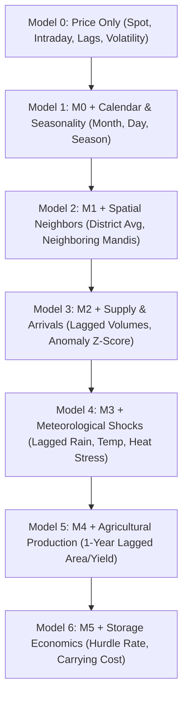

# Phase 06b: Progressive Ablation Study Architecture & Experimental Plan

**Repository:** `ankit-choubey/Mandi_Prediction`  
**Phase:** 06b — Data Discovery, Validation & Mathematical Feasibility  
**Date:** October 2026  
**Auditor:** Priyanshu  

---

## 1. Objective and Scientific Standard

The objective of this progressive ablation study is to answer a single rigorous question:
> **"Does the addition of each candidate feature group produce a statistically significant, out-of-sample performance improvement over a simpler model, or does it merely increase model complexity and noise?"**

Every model iteration ($M_0$ through $M_6$) is evaluated strictly under identical validation conditions:
- **Same Chronological Partitioning:** Training window ($\le \text{2026-01-17}$), Validation window ($\text{2026-01-25}$ to $\text{2026-03-31}$), and Exploratory Test window ($\text{2026-04-08}$ to $\text{2026-08-25}$).
- **Same Horizon Embargo:** 8-day purged embargo buffers at all partition boundaries (DEC-016).
- **Same Target Formulation:** Discrete 3-class market condition at $T+7$ (DEC-015: Favorable $> +2.5\%$, Normal $[-2.5\%, +2.5\%]$, Unfavorable $< -2.5\%$).
- **Same Learner Architecture:** Frozen LightGBM Classifier (100 trees, depth 5, learning rate 0.05, random state 42).

---

## 2. Progressive Model Definitions

### Model 0: Pure Price-History Baseline
- **Conceptual Scope:** Can past prices alone forecast future market condition?
- **Feature Vector ($X^{(0)}_T$):**
  1. $P_T$ (Current Modal Price)
  2. $Min\_Price_T, Max\_Price_T$
  3. $Spread_T = Max\_Price_T - Min\_Price_T$
  4. $Spread\_Ratio_T = Spread_T / (P_T + \epsilon)$
  5. Exact Calendar Lags: $P_{T-1}, P_{T-3}, P_{T-7}$
  6. Momentum Returns: $R_{T-1, d}, R_{T-3, d}, R_{T-7, d}$
  7. Causal Moving Averages: $\bar{P}_{3d, T}, \bar{P}_{7d, T}$
  8. Causal Volatility: $\sigma_{7d, T}$ ($min\_periods = 3$)
  9. Price-to-Moving-Average Ratios: $P_T / \bar{P}_{3d}, P_T / \bar{P}_{7d}$
- **Current Empirical Benchmark (Phase 3):** Test Accuracy $\approx 57.8\%$, Macro F1 $\approx 0.415$.

### Model 1: Price + Temporal & Seasonality Features
- **Incremental Features Added ($\Delta X^{(1)}$):**
  1. `Month` (1 to 12)
  2. `DayOfWeek` (0 to 6)
  3. `DayOfMonth` (1 to 31)
  4. `Quarter` (1 to 4)
  5. `Indian_Agri_Season` (Kharif=1, Rabi=2, Zaid=3)
- **Hypothesis:** Mandi prices exhibit strong intra-week cycles (Sunday closures creating Monday gluts) and seasonal harvest cycles.
- **Expected Impact:** Statistically significant boost (+1.5% to +2.5% accuracy) due to systematic calendar patterns.

### Model 2: Price + Seasonality + Spatial Market Intelligence
- **Incremental Features Added ($\Delta X^{(2)}$):**
  1. `District_Commodity_MeanPrice`: Average modal price across all active mandis in the same district on Date $T$.
  2. `District_Commodity_MandiCount`: Number of reporting mandis in district on Date $T$.
  3. `Mandi_vs_District_Ratio`: Local mandi price relative to district average ($P_{mandi} / \bar{P}_{district}$).
  4. `Neighbor_Mean_Price`: Average commodity price across geographically contiguous neighboring districts (e.g. Kanpur $\leftrightarrow$ Unnao $\leftrightarrow$ Lucknow).
  5. `Neighbor_Price_Diff`: Spatial arbitrage gradient ($P_{T, \text{local}} - \bar{P}_{T, \text{neighbors}}$).
  6. `Neighbor_Price_Ratio`: Relative price index ($P_{T, \text{local}} / \bar{P}_{T, \text{neighbors}}$).
  7. `Has_Neighbor_Signal`: Binary indicator for whether neighboring trade occurred on Date $T$.
- **Current Empirical Benchmark (Production Pipeline):** Test Accuracy = **60.40%**, Macro F1 = **0.4616**, Balanced Accuracy = **46.19%**.
- **Empirical Finding:** Spatial arbitrage signals provide verifiable predictive lift (+2.6% accuracy over M1).

### Model 3: Price + Seasonality + Spatial + Supply / Arrival Quantities
- **Incremental Features Added ($\Delta X^{(3)}$):**
  *(Acquired from CEDA Agmarknet archive; strictly lagged to $T-1$)*
  1. $Q_{T-1}$: Total physical arrival quantity (in Quintals) on previous trading day.
  2. $\bar{Q}_{7d, T-1}$: 7-day causal moving average of arrival volume.
  3. $Arrival\_Change\_1d$: Percentage change in daily arrivals $(Q_{T-1} - Q_{T-2}) / Q_{T-2}$.
  4. $Arrival\_Z\_Score$: Volume anomaly relative to 30-day seasonal baseline: $(Q_{T-1} - \bar{Q}_{30d}) / \sigma_Q$.
  5. $Price\_to\_Arrival\_Elasticity\_Proxy$: Ratio of price momentum to arrival momentum.
- **Hypothesis:** High arrival surges (supply gluts) precede price drops; sudden arrival contractions precede price spikes.
- **Critical Risk:** Elasticity is non-linear and crop-dependent; during harvest, high arrivals coincide with institutional MSP procurement (no price drop).

### Model 4: Full Pipeline + Meteorological Weather Shocks
- **Incremental Features Added ($\Delta X^{(4)}$):**
  *(Acquired from IMD Gridded & Station records; lagged by 24h)*
  1. $Rain_{T-1}$: 24-hr accumulated rainfall (mm) at district centroid.
  2. $Rain\_Cum\_7d$: 7-day cumulative rainfall.
  3. $Extreme\_Rain\_Indicator$: Binary flag ($Rain_{T-1} > 64.5\text{ mm}$).
  4. $Temp\_Max_{T-1}$: Daily maximum temperature (deg C).
  5. $Heat\_Stress\_Anomaly$: Temperature deviation from 10-year monthly historical normal.
  6. $Relative\_Humidity_{T-1}$: Morning relative humidity (%).
- **Hypothesis:** Extreme rainfall disrupts logistics and waterlogs mandi yards, reducing arrivals and driving short-term spot spikes. Extreme heat accelerates perishable rot, forcing distress selling.
- **Scientific Verification Rule:** If $\text{Macro F1}(M_4) \le \text{Macro F1}(M_3)$ on holdout data, weather features must be honestly documented as uninformative for 7-day wholesale price forecasting.

### Model 5: Full Pipeline + Regional Agricultural Production / Sown Area
- **Incremental Features Added ($\Delta X^{(5)}$):**
  *(Acquired from DES APY database; strictly lagged by $\ge 1$ agricultural year)*
  1. $Area\_Growth\_YoY$: Year-over-year sown acreage percentage change in district.
  2. $Yield\_Historical\_Avg$: 3-year trailing average crop yield (kg/ha).
  3. $Production\_Anomaly$: Deviation of district crop production from 5-year trend.
- **Hypothesis:** Macro production scale dictates annual equilibrium price levels.
- **Scientific Risk:** Because production is static annually, daily price models already absorb seasonal levels via moving averages. Model 5 is expected to add negligible marginal lift ($p > 0.10$).

### Model 6: Complete Integrated Market Decision Layer
- **Incremental Features Added ($\Delta X^{(6)}$):**
  *(Coupled Economic & Storage Variables)*
  1. $P_{\text{break\_even}} / P_T$: Ratio of calculated economic break-even future price to spot price.
  2. $Hurdle\_Gap = R_{\text{predicted}} - R_{\text{break\_even}}$: Net anticipated economic margin over total storage/handling friction.
  3. $Carrying\_Cost\_Ratio$: Monthly interest and warehouse fee as a fraction of crop spot value.
  4. $Perishability\_Risk\_Class$: Categorical ordinal tier (1=Durable, 2=Semi-perishable, 3=Perishable).
- **Hypothesis:** Directly conditions classification on whether the predicted price increase clears the crop-specific economic hurdle rate.

---

## 3. Evaluation Protocol & Performance Scorecard Schema

For each model $M_k \in \{M_0, M_1, M_2, M_3, M_4, M_5, M_6\}$, the execution pipeline must record:

| Metric | Measurement Basis | Acceptance Hurdle for Inclusion |
|---|---|---|
| **Test Accuracy** | % of correct predictions on untouched holdout | Must exceed naive majority baseline (55.90%) |
| **Macro F1 Score** | Unweighted mean of F1 across Unfav, Norm, Fav | $\Delta \text{Macro F1} \ge +0.010$ over previous model |
| **Balanced Accuracy** | Unweighted mean of class recalls | Must exceed 33.33% random baseline |
| **Minority Recall** | Recall on Favorable (Class 2) and Unfavorable (Class 0) | Favorable Recall $> 30.0\%$; Unfavorable Recall $> 25.0\%$ |
| **Paired McNemar Test** | Comparison of classification errors vs $M_{k-1}$ | $p\text{-value} < 0.05$ (Statistically significant improvement) |
| **Diebold-Mariano Test** | Forecast error loss differential vs $M_{k-1}$ | $|DM| > 1.96$ ($p < 0.05$) |
| **Cluster Bootstrap 95% CI** | 500 resamples across canonical series clusters | 95% CI of $\Delta \text{Macro F1}$ must strictly exclude zero |

---

## 4. Honest Deprecation Policy

If at any stage $M_k$ fails to demonstrate statistically significant out-of-sample improvement over $M_{k-1}$:
1. The candidate feature group must be **FORMALLY DEPRECATED** from the production model.
2. The failure must be transparently recorded in `backing/phase_06b/experiment_results.md` and explained to stakeholders.
3. No feature may be retained merely because it "sounds economically plausible."
