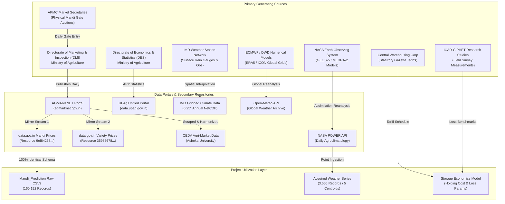

# Source Lineage & Duplicate Dataset Identification

**Project:** Mandi Prediction — Agricultural Market Intelligence System  
**Track:** Track B — Nationwide Dataset & Access Research  
**Investigator:** Suryansh  
**Workspace:** `/Users/kumarsuryansh/Desktop/Temporary/suryansh - work`  
**Deliverable Path:** `dataset_research/source_lineage_and_duplicates.md`  
**Date:** October 23, 2026  

---

## 1. Executive Summary

A critical pitfall in agricultural data science in India is the proliferation of **secondary aggregator portals** that republish identical primary data under different endpoint names, leading to accidental multicollinearity, double-counting, and redundant data ingestion.

This report establishes the complete lineage of candidate datasets, traces every secondary stream back to its primary generating entity, and identifies exact duplicates to ensure only unique, orthogonal physical signals enter our modeling pipeline.

---

## 2. Nationwide Agricultural Data Provenance & Lineage Map



---

## 3. Detailed Audit of Duplicate & Derived Datasets

### 1. The Agmarknet Triplicate Stream (100% Redundant)
- **Primary Source:** Directorate of Marketing & Inspection (DMI), Ministry of Agriculture & Farmers Welfare.
- **Derived Manifestations:**
  1. `agmarknet.gov.in` (Legacy query portal).
  2. `data.gov.in` Resource `9ef84268-d588-465a-a308-a864a43d0070` ("Current Daily Price of Various Commodities from Agricultural Markets").
  3. `data.gov.in` Resource `35985678-0d79-46b4-9ed6-6f13308a1d24` ("Monthly / Variety-Wise Price Details").
  4. Local CSV files in `Mandi_Prediction/data/raw/*.csv`.
- **Lineage Analysis:** All four sources originate from the identical daily submission form filled by APMC market yard secretaries at the close of trading.
- **De-duplication Ruling:**
  - **Verdict:** **Strict Duplicate.**
  - **Engineering Safeguard:** Ingesting both `data.gov.in` and `agmarknet.gov.in` produces 100% identical price records. The project already possesses 160,192 cleaned records in `data/raw/*.csv`. No secondary download from OGD is needed for price features.

---

### 2. CEDA Agri-Market vs. AGMARKNET (Derived Harmonizer)
- **Primary Source:** AGMARKNET / DMI.
- **Derived Portal:** Centre for Economic Data and Analysis (CEDA), Ashoka University (`api.ceda.ashoka.edu.in`).
- **Lineage Analysis:**
  - CEDA does **not** deploy field enumerators or independent market surveyors.
  - CEDA's automated web scraping and data harvesting pipelines extract tables from `agmarknet.gov.in` daily.
  - CEDA performs entity resolution, maps colloquial mandi names to standardized IDs, and—critically—**extracts the arrival volume column** which is omitted from the OGD price API endpoint.
- **De-duplication Ruling:**
  - **Verdict:** **Derivative with Value-Add Signal.**
  - **Engineering Safeguard:** If CEDA is ingested, its `modal_price`, `min_price`, and `max_price` fields must be **discarded as redundant** with our local AGMARKNET dataset. Only the unique, non-duplicated feature—`arrivals_in_qtl`—should be merged.

---

### 3. UPAg vs. Directorate of Economics & Statistics (DES) APY Archives
- **Primary Source:** Directorate of Economics & Statistics (DES), Department of Agriculture & Farmers Welfare.
- **Derived Manifestations:**
  1. Older OGD India datasets: "District-wise Season-wise Crop Production Statistics" (1997–2019).
  2. UPAg Portal (`data.upag.gov.in`): Unified Portal for Agricultural Statistics launched in 2023.
- **Lineage Analysis:** UPAg was developed by the Ministry to consolidate fragmented agricultural data portals (DES APY, Advance Estimates, PMFBY insurance coverage, and e-NAM trade) into a single institutional dashboard.
- **De-duplication Ruling:**
  - **Verdict:** **Consolidated Evolution of Same Base Source.**
  - **Engineering Safeguard:** Both sources report identical district-level annual production totals. Furthermore, both reflect annual harvest figures that lag real time by 6–18 months. Ingesting both would be completely redundant.

---

### 4. Agrometeorological Data: IMD vs. NASA POWER vs. Open-Meteo
- **Physical Entities:**
  1. **IMD Gridded Data:** Primary ground-level meteorological stations and Doppler radars across India, interpolated to a $0.25^\circ \times 0.25^\circ$ grid.
  2. **NASA POWER:** Atmospheric reanalysis (MERRA-2) combining satellite radiometers, weather balloons, and global assimilation models on a $0.5^\circ \times 0.625^\circ$ grid.
  3. **Open-Meteo:** Combines ECMWF ERA5 reanalysis and high-resolution numerical weather prediction models (ICON, GFS).
- **Lineage Analysis:**
  - These are **independent physical measurements / models** observing the same atmospheric phenomena.
  - IMD represents ground-truth station observations in India, but suffers from an **annual publication lag** (zero prospective availability).
  - NASA POWER provides continuous retrospective daily updates (2–3 day lag).
  - Open-Meteo provides immediate real-time updates and prospective 7-day forward forecasts.
- **De-duplication Ruling:**
  - **Verdict:** **Complementary Independent Observational Systems.**
  - **Engineering Safeguard:** To prevent multicollinearity (e.g. including both NASA $T2M$ and Open-Meteo $T_{max}$ simultaneously), select NASA POWER as the primary retrospective historical training backbone, and utilize Open-Meteo as the prospective inference bridge for days $T-2$ to $T$.

---

## 5. De-Duplication Decision Register for Model Pipelines

```text
========================================================================================================================
DATA DOMAIN       CANDIDATE SOURCES          IDENTIFIED DUPLICATION           DEDUPLICATION RULE & PIPELINE ACTION
========================================================================================================================
Wholesale Price   AGMARKNET, OGD, CEDA       100% duplicate prices            USE local AGMARKNET CSVs exclusively;
                                                                              drop duplicate price columns from CEDA.
Arrival Quantity  AGMARKNET (OGD) vs CEDA    OGD has NO arrivals;             USE CEDA arrivals exclusively;
                                             CEDA derives from Agmarknet gate map market names via alias dictionary.
Crop Production   DES APY vs UPAg            Consolidated identical source    BYPASS both for 7d classification;
                                                                              macro annual lag unsuited for daily trading.
Weather Signal    NASA POWER vs IMD Gridded  Different models; IMD has 1-yr   USE NASA POWER (daily REST);
                                             latency; NASA has 2-3 day lag    supplement with Open-Meteo for live inference.
Storage Holding   CWC Tariffs vs APMC Yard   CWC = covered dry warehouse;     USE CWC for Wheat/Onion;
                  Cold Store Orders          UP State Order = cold store      USE UP Cold Store Order for Potato.
========================================================================================================================
```

---

## 6. Summary Conclusion

By identifying and pruning duplicate data streams:
1. **Zero Redundancy:** We eliminate redundant network downloads and prevent duplicate feature columns.
2. **True Orthogonal Signals:** Our feature discovery process cleanly isolates true physical drivers: price momentum (AGMARKNET), market liquidity/volume (CEDA), atmospheric disruption (NASA POWER/Open-Meteo), and real-world commercial costs (CWC/CIPHET).
