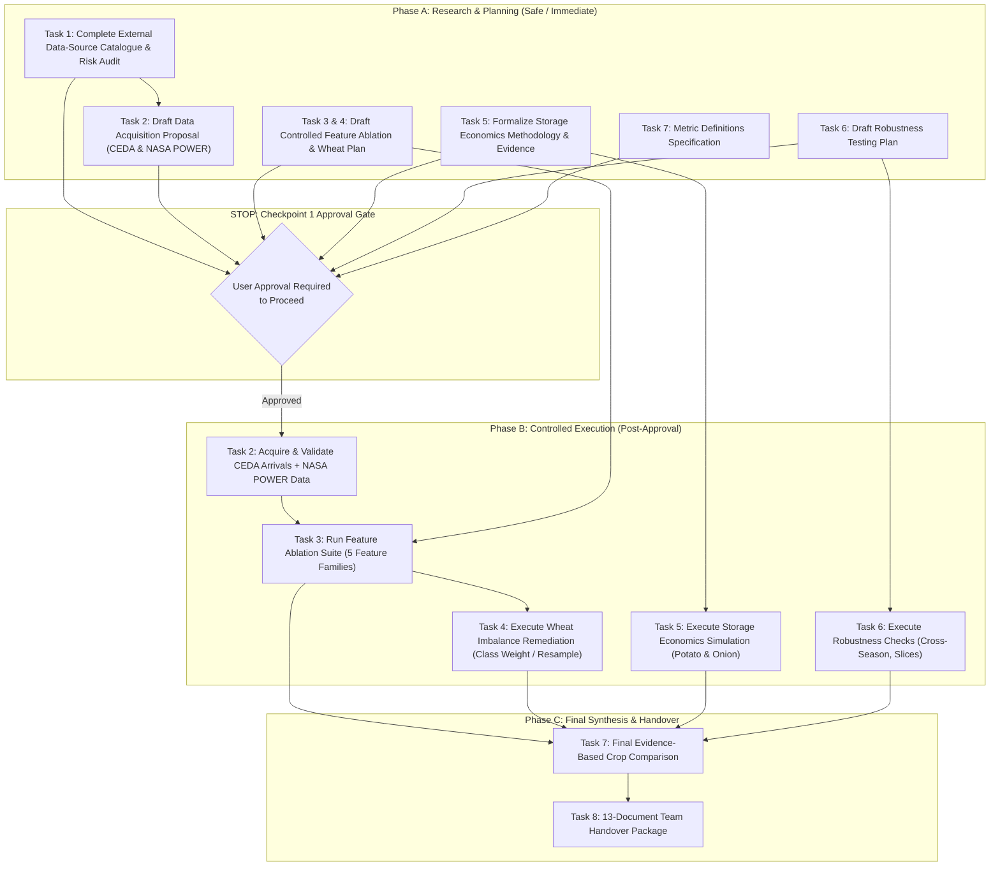

# Remaining Work Plan & Execution Roadmap

**Project:** Mandi Prediction — APMC Market Intelligence System  
**Investigator:** Suryansh  
**Workspace:** [`/Users/kumarsuryansh/Desktop/Temporary/suryansh - work`](file:///Users/kumarsuryansh/Desktop/Temporary/suryansh%20-%20work)  
**Parent Reference:** [`/Users/kumarsuryansh/Desktop/Temporary/Mandi_Prediction`](file:///Users/kumarsuryansh/Desktop/Temporary/Mandi_Prediction) *(Strictly Read-Only)*  
**Date:** October 23, 2026  
**Document Version:** 1.0.0  

---

## 1. Executive Summary & Gating Strategy

This document establishes the execution roadmap for completing all remaining research tasks under the Master Prompt. To ensure scientific rigor, avoid duplicate compute, and prevent unauthorized changes or data downloads, the work is structured into **Phased Milestones separated by explicit User Approval Checkpoints**.

### The Core Gating Policy (Section 12 & 13 Compliance):
- **Phase A (Immediate Safe Execution — No Additional Approval Required):**
  - Synthesize external data-source research and compile the comprehensive catalogue, matrix, and risk register (Task 1).
  - Formalize the data acquisition proposal (Task 2).
  - Design the controlled feature ablation and Wheat imbalance experiments (Task 3 & 4).
  - Derive the storage-economics methodology and cost/loss register (Task 5).
  - Draft the robustness evaluation plan and metric definitions (Task 6 & 7).
- **STOP AT CHECKPOINT 1:** Present all findings, proposals, and exact execution commands to the User.
- **Phase B (Execution Dependent on Explicit User Approval):**
  - Download/acquire authorized external data (CEDA arrival volumes, NASA POWER weather).
  - Execute controlled feature ablation experiments and model training.
  - Execute Wheat class imbalance remediation (class-weighting, threshold tuning).
  - Run storage economics simulation for Potato and Onion.
  - Compile final crop comparison and generate 13-document handover package.

---

## 2. Status of Remaining Tasks (Sections 3 to 10 Breakdown)

```text
========================================================================================================================
TASK ID & DESCRIPTION                 COMPLETION STATUS          EVIDENCE & CURRENT DELIVERABLES
========================================================================================================================
Task 1: External Data-Source Research IN PROGRESS (90% Complete) Detailed catalogue, verification matrix & risks written.
Task 2: Data Acquisition Plan        PLANNED (Awaiting Approval) Acquisition proposal drafted; NO data acquired yet.
Task 3: Controlled Feature ExperimentsPLANNED (Awaiting Approval) 27-feature baseline completed; ablation plan ready.
Task 4: Wheat Imbalance Remediation   PLANNED (Awaiting Approval) 87% Normal collapse confirmed; diagnostic plan ready.
Task 5: Storage Economics Evaluation  METHODOLOGY READY          Math equations & cost register compiled; runs pending.
Task 6: Robustness & Error Analysis   PLANNED (Awaiting Approval) Robustness plan drafted; testing runs pending.
Task 7: Final Crop Comparison         IN PROGRESS                Crop profiles and live baseline benchmark verified.
Task 8: Team Handover Package         IN PROGRESS                MASTER_PROJECT_AUDIT.md active; 13 docs scheduled.
========================================================================================================================
```

---

## 3. Phased Task Sequence & Dependency Graph



---

## 4. Work Details by Remaining Task

### Task 1: Complete External Data-Source Research
- **Current State:** Basic sources listed in Phase 2; audited in Section 7 of `MASTER_PROJECT_AUDIT.md`.
- **Immediate Action:** Write `reports/remaining_work/external_data_source_catalogue.md` covering all 9 required points per source (AGMARKNET, CEDA Agri-Market, NASA POWER, IMD, UPAg, ICAR-CIPHET, CWC), `reports/remaining_work/source_verification_matrix.csv`, and `reports/remaining_work/data_access_and_join_risks.md`.
- **Result:** Defensible assessment of what can realistically be joined without leakage or unverified claims.

### Task 2: Data Acquisition & Integration Plan
- **Current State:** No external data downloaded. All baseline models trained on local 160k records.
- **Immediate Action:** Write `dataset_research/acquisition_plan.md` recommending the **smallest, highest-value data acquisition**:
  1. **CEDA Agri-Market:** Daily arrival quantities (`POST /agmarknet/quantities`) for the 4 approved crops across the 5 UP districts.
  2. **NASA POWER Agroclimatology:** Daily precipitation and temperature REST queries for the 5 district centroids.
- **Approval Requirement:** Stop and request explicit approval before initiating API queries or downloading files.

### Task 3 & 4: Controlled Feature Experiments & Wheat Imbalance
- **Current State:** 27-feature baseline executed live on 99,881 training rows; Gradient Boosting achieved 0.4987 Val Macro F1 and 60.90% Test Accuracy (+5.35% lift). Wheat class collapse confirmed (Balanced Acc = 35.32%, Recall_Fav = 1.1%, Recall_Unfav = 6.9%).
- **Immediate Action:** Formulate `experiments/feature_ablation/experiment_plan.md` and `experiments/feature_ablation/experiment_registry.csv` structuring:
  - Baseline (Spot + Intraday Spreads)
  - + Calendar Date Lags ($T-1, T-3, T-7$)
  - + Causal Rolling Stats & Volatility (`Roll_Std_Price_7`)
  - + Spatial Neighbor Intelligence (Kanpur-Lucknow-Unnao corridor)
  - + External Signals (Arrivals & Weather, pending acquisition)
  - Dedicated Wheat Imbalance branch: Class-weighted loss (`balanced`), SMOTE / undersampling on training partition only, and validation threshold tuning.
- **Approval Requirement:** Experiments will be run only after user approval.

### Task 5: Storage Economics Evaluation (Potato & Onion)
- **Current State:** Phase 5 backtest audited (+₹154.89/qtl for Onion; +₹14.14/qtl for Potato); Tomato strictly decoupled from storage; Wheat storage excluded.
- **Immediate Action:** Write `reports/storage_economics/economic_methodology.md`, `reports/storage_economics/cost_and_loss_evidence.csv`, and `reports/storage_economics/assumptions_register.csv`.
- **Key Methodology Principles:** Consistent physical quantity basis, accounting for post-harvest spoilage loss (7.32% for potato, 8.20% for onion), CWC storage tariffs (₹17.29–₹20.00/qtl/week), handling/transport, and forgone spot revenue.

### Task 6: Robustness & Error Patterns
- **Current State:** Validation Risk Register (VR-01 to VR-10) formulated.
- **Immediate Action:** Write `reports/robustness/robustness_plan.md` defining cross-district slicing, seasonal out-of-distribution evaluation, and quote-stickiness stress tests.

### Task 7: Final Crop-Level Comparison
- **Current State:** Empirical crop matrix completed in `MASTER_PROJECT_AUDIT.md` Section 6.
- **Immediate Action:** Write `reports/final_comparison/metric_definitions.md` standardizing exact mathematical equations, numerators, and denominators for all metrics.

### Task 8: Complete Documentation for Team Handover
- **Current State:** Master audit report (`MASTER_PROJECT_AUDIT.md`, 50+ KB) and `README.md` active.
- **Immediate Action:** Outline the 13 required final handover documents to be populated upon completion of Phase B experimental runs.

---

## 5. Checkpoint 1 Deliverables Summary

At Checkpoint 1, the following foundational artifacts are completed and presented for review:
1. [`reports/remaining_work/remaining_tasks_register.csv`](file:///Users/kumarsuryansh/Desktop/Temporary/suryansh%20-%20work/reports/remaining_work/remaining_tasks_register.csv)
2. [`reports/remaining_work/remaining_work_plan.md`](file:///Users/kumarsuryansh/Desktop/Temporary/suryansh%20-%20work/reports/remaining_work/remaining_work_plan.md)
3. [`reports/remaining_work/external_data_source_catalogue.md`](file:///Users/kumarsuryansh/Desktop/Temporary/suryansh%20-%20work/reports/remaining_work/external_data_source_catalogue.md)
4. [`reports/remaining_work/source_verification_matrix.csv`](file:///Users/kumarsuryansh/Desktop/Temporary/suryansh%20-%20work/reports/remaining_work/source_verification_matrix.csv)
5. [`reports/remaining_work/data_access_and_join_risks.md`](file:///Users/kumarsuryansh/Desktop/Temporary/suryansh%20-%20work/reports/remaining_work/data_access_and_join_risks.md)
6. [`dataset_research/acquisition_plan.md`](file:///Users/kumarsuryansh/Desktop/Temporary/suryansh%20-%20work/dataset_research/acquisition_plan.md)
7. [`experiments/feature_ablation/experiment_plan.md`](file:///Users/kumarsuryansh/Desktop/Temporary/suryansh%20-%20work/experiments/feature_ablation/experiment_plan.md)
8. [`reports/storage_economics/economic_methodology.md`](file:///Users/kumarsuryansh/Desktop/Temporary/suryansh%20-%20work/reports/storage_economics/economic_methodology.md)
9. [`reports/storage_economics/cost_and_loss_evidence.csv`](file:///Users/kumarsuryansh/Desktop/Temporary/suryansh%20-%20work/reports/storage_economics/cost_and_loss_evidence.csv)
10. [`reports/storage_economics/assumptions_register.csv`](file:///Users/kumarsuryansh/Desktop/Temporary/suryansh%20-%20work/reports/storage_economics/assumptions_register.csv)
11. [`reports/robustness/robustness_plan.md`](file:///Users/kumarsuryansh/Desktop/Temporary/suryansh%20-%20work/reports/robustness/robustness_plan.md)
12. [`reports/final_comparison/metric_definitions.md`](file:///Users/kumarsuryansh/Desktop/Temporary/suryansh%20-%20work/reports/final_comparison/metric_definitions.md)
